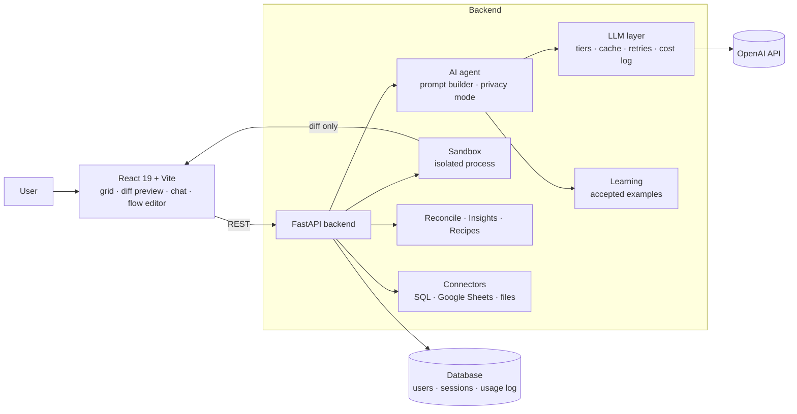

# AI Data Studio

**Work with spreadsheets and databases in plain language. Describe the change — the AI writes the code, runs it in an isolated sandbox, and shows you a diff before anything touches your data.**

🏗️ [Architecture](#architecture) · 📩 [Contact](#contact)

> This repository is a showcase. AI Data Studio is a commercial SaaS and its source code is private. Code walkthroughs are available on request.

---

## The problem

Small businesses run on spreadsheets: bank statements, CRM exports, accounting files, old and new systems after a migration. Cleaning and reconciling them means Excel formulas, Power Query or a Python script — so it waits for the one technical person on the team.

Generic AI chat doesn't fix this. You paste data into a chat, copy an answer back, and hope it was right. Nothing is previewed, nothing is reversible, and your data has been sent to a third party in full.

## The solution

1. **Bring your data** — upload CSV, Excel or a `.sql` dump, connect PostgreSQL / MySQL, or paste a Google Sheets link.
2. **Ask in plain language** — *"remove duplicates and add a Total column"*.
3. **Review the diff** — the AI generates code, it runs in a sandbox, and you see exactly which rows and cells will change. Nothing is applied without your confirmation.
4. **Apply, undo, repeat** — full undo/redo, saved AI conversations, multiple tables side by side.
5. **Reconcile two different sources** — bank statement vs. accounting, CRM vs. ERP: columns are matched automatically and only the differences come back.

---

## Key features

- **Preview before every change** — a diff of rows and cells for every AI operation, recipe or quick fix
- **Sandboxed code execution** — AI-generated pandas code runs in an isolated process with AST validation, attribute guards and resource limits
- **Three privacy modes** — from *Max quality* to *Private*, where **no cell value ever leaves the server**: the model sees only the schema
- **Smart reconciliation** — matches columns across differently structured tables (names, synonyms, value overlap), picks the join key, returns only discrepancies
- **Data quality insights** — detects duplicates, empty rows, missing values, numbers and dates stored as text, with one-click fixes
- **Recipes** — common operations that run instantly with no AI call and no quota spent
- **Gets better with use** — similar requests the user previously *accepted* are added to the prompt as examples, so the AI adapts to each user's style without fine-tuning
- **Multi-table work** — split view, merging, AI chat with saved conversations
- **Database connections** — PostgreSQL and MySQL with encrypted credentials and no raw SQL from the user
- **SaaS-ready** — accounts, Free / Pro / Team plans with Stripe, usage quotas, admin panel, legal pack (ToS, Privacy, DPA, AUP, Refund, Cookies) in English, Polish and Ukrainian
- **Interface in 14 languages**, own design system (OKLCH colours)

---

## Architecture

### How one AI operation works

1. The backend builds a **typed schema** of the table: the real type of each column and the format it was written in (`1 200,50` stays `1 200,50` for the user, but the model knows it is a number).
2. The prompt is assembled with the **static part first** (role, rules, examples) and the dynamic part last (schema, other tables, history, task). This keeps the prefix identical between requests so provider-side prompt caching applies, which makes that part about 10× cheaper.
3. Depending on the **privacy mode**, the schema includes sample values or only column names and types.
4. The model returns code through **structured output** (a JSON schema), not free text parsed with regex.
5. The code runs in the **sandbox**; the result comes back as a diff. The user applies or discards it, and that decision is logged.

### Design decisions

| Decision | Why |
|---|---|
| **The model writes code, the sandbox runs it** | Data is changed deterministically by pandas, not rewritten by the model. Results are exact and reviewable. |
| **Defence-in-depth sandbox** | Separate process with timeout and memory limits, cleared environment variables, isolated working directory, AST validation (no imports, no dunder access, no pandas file/network I/O), and a guard that rewrites every attribute access so no module object can be reached. Only simple types travel back to the parent process. Built after an internal security audit found two sandbox escapes — both fixed. |
| **No change without a preview** | Every path — AI, recipe, quick fix — goes through the same diff preview. One execution path is easier to secure and test. |
| **One LLM layer for the whole app** | Model tiers, token limits, timeouts, retries, cost logging and escalation to a stronger model live in one place. Switching a model is a one-line change. |
| **Prompt structure optimised for caching** | Static prefix first, dynamic data last; schema compressed about 3×; formatting rules added only when the task is about formatting. |
| **Learning from accepted operations instead of fine-tuning** | Fine-tuning needs thousands of examples and ties the product to one model version. Accepted request → code pairs from the user's own history give a similar effect today, with no training cost. |
| **Recipes without AI** | Deterministic operations should be instant, free and identical every time. Recipes also teach users what to ask and serve as style examples for the model. |
| **Deterministic reconciliation, AI only as an option** | Column matching uses name normalisation, a synonym dictionary and value overlap (Jaccard). Only discrepancies are returned, so the browser's row limit does not apply. |
| **Privacy as a product feature** | The *Private* mode sends only the schema; the UI states exactly what is sent to the model in each mode. |

---

## Quality and security

- **296 backend tests**; CI on GitHub Actions runs the tests and the frontend build on every push and pull request
- **Security audit** across OWASP Top 10, authentication and sessions, access control, headers, PII/GDPR, dependencies and business logic, with a follow-up audit; critical findings (sandbox escapes, file write via `.sql` import) fixed and documented
- **SSRF protection** for Google Sheets and database connections, Fernet-encrypted credentials, rate limiting, quota checks on every AI endpoint
- **Production setup** with Docker Compose

---

## Tech stack

**Frontend:** React 19 · Vite · custom grid · own design system (OKLCH) · i18n (14 languages)
**Backend:** Python · FastAPI · SQLAlchemy · pandas · NumPy
**AI:** OpenAI API · structured outputs · prompt caching · tiered models with escalation
**Integrations:** PostgreSQL · MySQL · Google Sheets · Stripe
**Tooling:** pytest · GitHub Actions · Docker

---

## My role

I am the owner and architect of AI Data Studio:

- defined the product, its positioning and pricing
- designed the architecture: LLM layer, sandbox, privacy modes, preview-first data flow, reconciliation
- ran two security audits with AI tooling, reviewed the findings and drove the fixes
- optimised LLM cost: prompt caching structure, schema compression, model tiers
- built it with AI coding agents, with tests and CI as the safety net

## Contact

Interested in a live demo, a pilot or licensing? → [LinkedIn](https://www.linkedin.com/in/roman-dovhal/)

---

© 2026 Roman Dovhal. All rights reserved. This repository contains no product source code.
